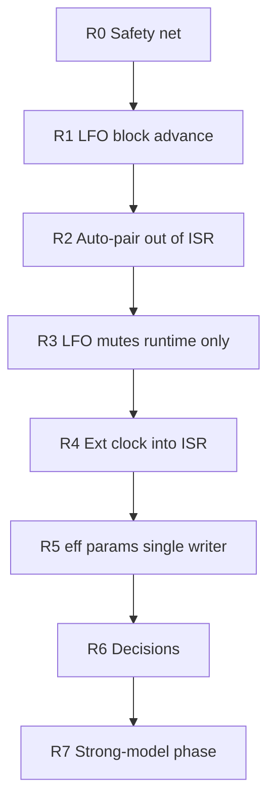

# KO RYTM Refit – Ausführungsplan für Composer / Grok

Repo-Root: `/Users/kosmar/.cursor/m vave fm1`. Alle Pfade relativ dazu.
Zeilennummern sind nur Hinweise. **Code immer per Symbolname finden** (`rg -n 'symbol' firmware/src/rytm.c`).
Erster Schritt der Ausführung: diesen Plan nach `docs/rytm-refit-plan.md` kopieren und committen (`docs: add rytm refit plan`).

---

## 0. Grundregeln (vor jedem Schritt lesen)

1. Vorbedingung: `git status --porcelain` ist leer. Sonst STOPP und den User bitten zu committen. Nie stash, reset, checkout, amend.
2. Ein Schritt = ein Commit. Nichts außerhalb der Dateiliste des Schritts anfassen. Kein Refactor „nebenbei“.
3. Nach jedem Schritt den **Verify**-Block ausführen. Schlägt etwas fehl: `git checkout -- <Dateien dieses Schritts>`, berichten, STOPP.
4. **Nie ändern** (außer ein Schritt sagt es ausdrücklich): Feldreihenfolge/Typen von `rytm_cfg_t`, `rytm_cfg_s16_t`, `rytm_lfo_cfg_t`, `RYTM_CFG_FIELDS`; `RYTM_CFG_MAGIC*`; Werte/Reihenfolge der `LFO_TGT_*`-Enums; MIDI-CC-Nummern in `apply_cc`; Preset-Daten in `firmware/src/rytm_data.h`.
5. Keine `float`/`double`, keine 64-Bit-Division (siehe `docs/RULES.md`). Im Audio-Pfad (`app_audio` und alles, was es aufruft) kein Flash, kein Screen, kein `platform_poll()`.
6. Schritte mit **[DECISION]** nicht ausführen, bevor der User zugestimmt hat. Nur die Frage stellen.
7. Ausgaben über ~100 Zeilen (Build-Logs, Diffs) per `| delegate "Nur Fehler mit Datei:Zeile. Keine Paraphrase. Unbekannt = unbekannt."` zusammenfassen.

### Kontexte in rytm.c (wichtig für alle Schritte)
- **Audio-ISR**: `app_audio` → `seq_advance` → `build_query` → `sync_effective_params`, `fire_step_events`; außerdem `refresh_kit`, `morph_clock`, `lfo_step_all_slots`.
- **Main-Loop**: `app_step`, `handle_keys`, `knob_adjust`, `mark_dirty`, `apply_cc`, alle `draw_*`.
- Ziel: jede Variable hat **genau einen** schreibenden Kontext. `g.cfg` wird **nur** vom Main-Loop und nur aus User-Aktionen geschrieben.

### Risiko-Tags
- **[AUDIO=]** WAV-Hash muss bit-identisch bleiben.
- **[AUDIO~]** WAV-Hash darf sich ändern; danach neue Baseline speichern (Label im Schritt).
- **[UI]** nur Screens.
- **[SAVE]** Layout-Probe muss unverändert bleiben.

---

## 1. Ablauf



Alles seriell (alle Schritte berühren `firmware/src/rytm.c`). Keine parallelen Worktrees.

---

## 2. Schritte

### R0 – Sicherheitsnetz · Risiko keins
Dateien: `tests/snapshot.sh`, `tests/cfg_layout.c` (neu, falls nicht vorhanden), `tests/rytm_cfg_purity.c` (neu).

**R0a** – Wenn `tests/snapshot.sh` nicht existiert: Schritt **S1** aus [docs/centralization-plan.md](docs/centralization-plan.md) exakt so umsetzen (Skript und `cfg_layout.c` stehen dort vollständig). Commit wie dort angegeben.

**R0b** – `tests/rytm_cfg_purity.c`: Host-Test, der beweist, dass der Audio-Pfad `g.cfg` nicht verändert. Muster wie `tests/cfg_layout.c` (rytm.c per `#include` mit `#define main …` einbinden):
```c
/* SPDX-License-Identifier: GPL-3.0-only */
/* KO RYTM: app_audio must never write g.cfg (LFO mutes, auto pair). */
#define main rytm_host_main
#include "rytm.c"
#undef main
int main(void)
{
    static int32_t buf[256 * 2];
    static rytm_cfg_t before;
    uint32_t i;
    app_init();
    g.cfg.lfo.depth[LFO_TGT_ENSEMBL] = 100u;
    g.cfg.lfo.depth[LFO_TGT_SEQ_FLIP] = 100u;
    g.cfg.drummer_auto = 1u;
    g.cfg.bassist_auto = 1u;
    g.cfg.lfo.depth[LFO_TGT_GENRE] = 127u;
    g.playing = 1u;
    before = g.cfg;
    for (i = 0; i < 4000u; i++)
        app_audio(buf, 256u);
    if (memcmp(&before, &g.cfg, sizeof before) != 0) {
        printf("rytm_cfg_purity: FAIL g.cfg changed in audio path\n");
        return 1;
    }
    printf("rytm_cfg_purity: OK\n");
    return 0;
}
```
Build/Run:
```sh
cc -O0 -w -DDINGHY_HOST -Ifirmware/src -Ifirmware/gen -DAPP_VER='"dev"' -o build/rytm_purity tests/rytm_cfg_purity.c && build/rytm_purity
```
Erwartung **jetzt: FAIL** (dokumentiert den Bug). Im Commit-Body vermerken. Ab R3 muss es OK sein.

Verify: `tests/snapshot.sh save rytm-base rytm && tests/snapshot.sh check rytm-base rytm`
Commit: `tests: rytm snapshot baseline and cfg purity probe`

---

### R1 – LFO-Phasen pro Block statt pro Sample · [AUDIO=]
Datei: `firmware/src/rytm.c`, nur `app_audio`.

Heute zählt die Sample-Schleife 53 Phasen pro Sample hoch. Ausgewertet werden sie erst nach der Schleife (`lfo_step_all_slots`). Ersetzen durch einen Vorschub pro Block **vor** der Sample-Schleife:
```c
for (t = 0; t < LFO_NTARGETS; t++) {
    uint64_t adv = (uint64_t)inc[t] * (uint64_t)n;
    uint64_t sum = (uint64_t)g.lfo_ph[t] + adv;
    g.lfo_ph[t] = (uint32_t)sum;
    g.lfo_cycle[t] += (uint32_t)(sum >> 32);
}
```
Die innere `for (t …)`-Schleife in der Sample-Schleife löschen. Nur Multiplikation und Shift, keine 64-Bit-Division. Phase und Cycle-Zähler sind mathematisch identisch, weil zwischendurch niemand sie liest. **Prüfen:** `rg -n 'lfo_ph|lfo_cycle' firmware/src/rytm.c`. Liest `seq_advance` oder etwas darunter sie innerhalb der Sample-Schleife, STOPP und berichten.
Den Detune-Term (`det`) **nicht** anfassen (siehe R6a).

Verify: `tests/snapshot.sh check rytm-base rytm` (bit-identisch)
Commit: `rytm: advance LFO phases once per audio block`

---

### R2 – Auto-Pair aus dem Audio-ISR · [AUDIO~]
Datei: `firmware/src/rytm.c`.

Den Block `if (g.cfg.drummer_auto || g.cfg.bassist_auto) { … }` aus `app_audio` unverändert in eine neue Funktion `static void rytm_auto_pair_poll(void)` verschieben. Aufruf in `app_step` einmal pro Durchlauf (vor dem Draw). `refresh_kit` im ISR liest `g.cfg.drummer`/`g.cfg.bass.model` weiter nur lesend. Danach schreibt der ISR diese Felder nicht mehr.

Verify:
- `rg -n 'g\.cfg\.(drummer|bassist|bass\.model) *=' firmware/src/rytm.c` → kein Treffer innerhalb von `app_audio` oder davon aufgerufenen Funktionen.
- `tests/snapshot.sh check rytm-base rytm --audio`: Der WAV-Hash darf sich ändern (Morph startet bis zu einen Loop-Durchlauf später). Danach `tests/snapshot.sh save rytm-r2 rytm`.

Commit: `rytm: run drummer/bassist auto pair in main loop, not in audio`

---

### R3 – LFO-Mutes nur zur Laufzeit, nie in `g.cfg` · [AUDIO~] [UI]
Datei: `firmware/src/rytm.c`.

Problem: `rytm_apply_lfo_seq_mutes` ruft `rytm_apply_mute_mask` auf. Das schreibt `g.cfg.dv[].mute`, `g.cfg.bass_mute` und `g.cfg.solo_mask`, die modulierten Mutes landen im Flash.

1. In der App-Struct (nicht in `rytm_cfg_t`!) neu: `uint8_t lfo_mute_on; uint8_t lfo_mute_mask;`.
2. `rytm_apply_lfo_seq_mutes`: Ist keine der beiden Tiefen (ENSEMBL, SEQ_FLIP) > 0, `g.lfo_mute_on = 0` setzen und zurück. Sonst `dm` wie heute berechnen, dann `g.lfo_mute_mask = dm; g.lfo_mute_on = 1;`. **Kein** Aufruf von `rytm_apply_mute_mask`, **kein** Schreiben von `solo_mask`.
3. Neue Funktion `static uint8_t rytm_eff_mute_mask(void)`: liefert `g.lfo_mute_on ? g.lfo_mute_mask : rytm_target_mute_mask()`.
4. Verbraucher umstellen:
   - `rytm_sync_heard_mutes`: `g.heard_mute_mask = rytm_eff_mute_mask();`
   - `sync_effective_params`: `g.eff_dv[v].mute = (rytm_eff_mute_mask() >> v) & 1u;`
   - Bass-Mute im Audio/Trigger-Pfad: `rg -n 'bass_mute' firmware/src/rytm.c firmware/src/rytm_dsp.h`. Jeder **lesende** Zugriff im ISR-Pfad (`fire_step_events`, Trigger, Render) nutzt `(rytm_eff_mute_mask() >> 7) & 1u`. UI-Zugriffe (`draw_*`, `voice_audible`, Mute/Solo-Toggles) bleiben auf `g.cfg`.
5. `rytm_apply_ensemble` (User-Aktion) und `rytm_apply_mute_mask` selbst bleiben unverändert. User-Intent darf `g.cfg` schreiben.

Verify:
- `build/rytm_purity` (Befehl aus R0b): Der Mute-Teil darf `g.cfg` nicht mehr ändern. Ändert sich `g.cfg` noch, die Abweichung finden: zusätzlich einen `memcmp` pro Feldgruppe in den Test einbauen und ausgeben. Bleibt nur `sync_effective_params`-Nebenwirkung übrig, ist R5 zuständig. Ab hier muss der Test **OK** sein.
- `tests/snapshot.sh check rytm-r2 rytm`: WAV darf gleich bleiben oder sich ändern; Layout muss gleich bleiben. Danach `tests/snapshot.sh save rytm-r3 rytm`.

Commit: `rytm: keep LFO ensemble/flip mutes out of saved config`

---

### R4 – Externe Clock im Audio-Kontext · [AUDIO~] (timing-sensitiv)
Datei: `firmware/src/rytm.c`.

Heute ruft der Main-Loop bei `0xF8` direkt `seq_advance()` auf, und bei `0xFA` direkt `transport_reset()`. Damit schreiben zwei Kontexte Sequencer- und Synth-State.

1. App-Struct neu: `uint32_t ext_f8_in; uint32_t ext_f8_done; uint8_t xport_reset_req; uint32_t ext_last_ms;`
   - `ext_f8_in`, `xport_reset_req` (setzen), `ext_last_ms`: Writer ist der Main-Loop.
   - `ext_f8_done`, `xport_reset_req` (löschen): Writer ist der ISR.
2. Main-Loop (MIDI-Schleife in `app_step`):
   - `0xF8`: `g.ext_clock = 1; g.ext_last_ms = fm1_ms; if (g.playing) g.ext_f8_in++;`
   - `0xFA`: `g.ext_f8_done = g.ext_f8_in;` darf der Main-Loop **nicht** schreiben. Stattdessen `g.xport_reset_req = 1; g.playing = 1; g.ext_clock = 1;`
   - Alle anderen Main-Loop-Aufrufe von `transport_reset()` (PLAY-Button, `rg -n 'transport_reset\(\)'`) ebenfalls durch `g.xport_reset_req = 1;` ersetzen. Ausnahme ist `app_init`, dort läuft noch kein Audio.
   - Timeout: Ist `g.ext_clock && fm1_ms - g.ext_last_ms > 1000u`, dann `g.ext_clock = 0`.
3. `app_audio`, ganz am Anfang:
```c
if (g.xport_reset_req) {
    transport_reset();
    g.ext_f8_done = g.ext_f8_in;
    g.xport_reset_req = 0u;
}
if (g.ext_clock) {
    uint32_t k = 0u;
    while (g.ext_f8_done != g.ext_f8_in && k < 8u) {
        g.ext_f8_done++;
        k++;
        g_evt_ofs = 0u;
        seq_advance();
    }
}
```
   `k < 8` begrenzt den Nachholbedarf nach langen Main-Loop-Stalls.
4. `rg -n 'seq_advance\(\)'` darf danach nur noch Aufrufe in `app_audio` zeigen.

Verify:
- `tests/rytm_test.txt` enthält keine F8. `tests/snapshot.sh check rytm-r3 rytm` sollte bit-identisch sein. Ist es das nicht, STOPP und berichten.
- Neuer Host-Test `tests/rytm_clock_ext.c` nach Muster von `tests/bass_clock_ext.c`: `app_init`; F8 simulieren (`g.ext_clock = 1; g.ext_f8_in++` im 24-PPQN-Abstand bei 120 BPM, Blockgröße 256); prüfen, dass `g.step` nach 96 Pulsen (= 1 Takt) genau 16 Schritte weiter ist.

Commit: `rytm: consume external MIDI clock and transport resets in audio context`

---

### R5 – `sync_effective_params` nur im ISR · [UI]
Datei: `firmware/src/rytm.c`. Voraussetzung: R4 ist gemergt.

1. `rg -n 'sync_effective_params\(\)|build_query\(' firmware/src/rytm.c`. Für jeden Aufrufer feststellen, ob er im ISR-Kontext liegt (Liste in Abschnitt 0).
2. Aufrufe aus dem Main-Loop entfernen. Bekannt sind `mark_dirty` und `app_init` (dort bleibt er, weil vorher noch kein Audio läuft). Weitere Main-Loop-Aufrufe, etwa aus `draw_*` oder `knob_adjust`, ebenfalls entfernen. Die Werte sind spätestens nach einem Audio-Block (≤ 6 ms) frisch.
3. `mark_dirty`: den Zweig `if (!g.playing) { rytm_apply_lfo_seq_mutes(); rytm_sync_heard_mutes(); }` in den ISR verlegen, nach `lfo_step_all_slots()` in `app_audio`, mit `if (!g.playing)`.

Verify:
- `build/rytm_purity` → OK.
- `tests/snapshot.sh check rytm-r3 rytm --audio`: Der WAV-Hash sollte gleich bleiben (der Audio-Pfad ruft die Funktion ohnehin selbst). PPMs dürfen sich um einen Frame unterscheiden. Danach `tests/snapshot.sh save rytm-r5 rytm`.

Commit: `rytm: compute effective params only in audio context`

---

### R6 – Entscheidungen · [DECISION] – nur fragen, nicht ausführen
- **R6a LFO-Detune:** In `app_audio` macht `det = ((int32_t)t - 2) * (base_inc >> 9)` jeden Slot leicht verstimmt, dadurch driften „1 BAR“-LFOs gegen den Takt. Frage an den User: entfernen (bar-locked) und bei Play die Phasen auf `g.cfg.lfo.phase[t] << 25` zurücksetzen, wie `fm_lfo_slots_sync_restart` in KIT? [AUDIO~]
- **R6b Manuelles SAVE beim Spielen:** `BTN_SAVE` in `app_step` ruft `settings_save` sofort auf, der Flash-Erase stoppt dabei den Sound. Vorschlag: Bei `g.playing` nur `g.set_dirty = 1` plus Flag `save_req` setzen und speichern, sobald gestoppt oder `rytm_synth_is_quiet`; bis dahin „SAVE ON STOP“ anzeigen.
- **R6c Knob-Readout:** `knob_value` mischt `eff_*` und `g.cfg.*`. Frage: überall den gespeicherten Basiswert zeigen (Regel aus fm_app K3) und die Modulation nur als Balken/Range?
- **R6d LFO depth 0 überspringen:** In `lfo_step_all_slots` Slots mit `depth == 0` überspringen und `g.lfo_sm[t] = 0` setzen. Spart Rechenzeit im ISR, ändert aber den Slew-Einstieg beim Aufdrehen der Tiefe. [AUDIO~]

---

### R7 – Nicht für Composer/Grok (starkes Modell, eigener Plan)
Nur zur Info, nicht ausführen:
- LFO auf `fm_lfo_slot_t` + `fm_lfo_slots_step_tr` umstellen (wie `deck_apply_lfo_block` in `firmware/src/deck.c`). Das bricht `rytm_lfo_cfg_t` und braucht Migration.
- Versionierter, segmentierter Store statt 7-KB-Blob (Vorbild `deck_load_v3…v7`, `firmware/src/deck_store.h`). Zusammen mit dem LFO-Umbau, ein Formatbruch statt zwei.
- Knob-Deskriptor statt vier paralleler Switches (`knob_adjust`, `knob_value`, `knob_bar_px`, `knob_label`), entspricht K5 im Centralization-Plan.
- Chrome: `ko_chrome.h`, Toasts, `perf_toast_policy.h`, Era/Plate (X3 im Centralization-Plan).
- Formatierungs-Helfer und SEQ-Suffixe: Schritte F3/L3 im Centralization-Plan, sobald `fm_fmt.h` existiert.

---

## 3. Abschlussbericht des Executors
Pro Schritt: Commit-Hash, Verify-Ergebnis (OK/FAIL), gespeicherte Baseline-Labels und offene [DECISION]-Fragen. Keine Zusammenfassung des Diffs.